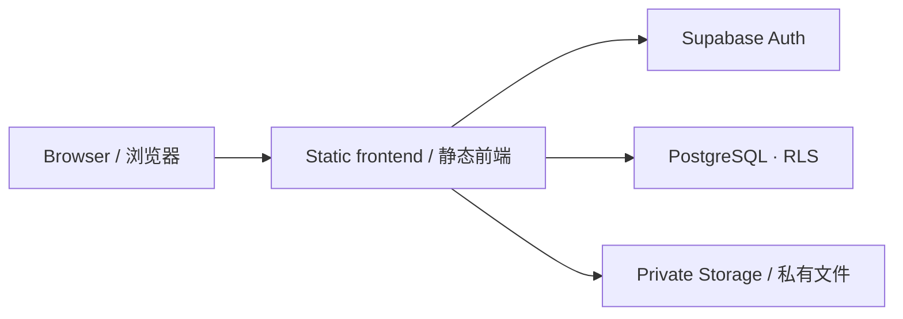

# 翎语 Lingo · Personal Growth OS

**走出信息边界，发现更多可能。**  
**Go beyond what you know. Discover what comes next.**

[简体中文](#zh-cn) · [English](#en) · [体验平台 / Live website](https://www.lingozm.cn/) · [本地运行 / Quick start](#quick-start) · [MIT License](LICENSE)

<a id="zh-cn"></a>

## 中文介绍

### 翎语是什么？

翎语是面向大学生的成长与协作平台，把**机会发现、课程学习、项目实践、社区组队和个人作品展示**连接在一起。

想参加一场比赛，却不知道从哪里找起；想学点新技能，却缺少顺手的材料；有一个点子，却还没遇到一起行动的人——翎语希望让这些起点变得更容易。从看见一个机会，到学会一项技能、找到一位伙伴，再到留下自己的作品，每一步都可以在同一个空间里发生。

这个仓库开放平台的应用源码、数据库迁移、开发示例与测试，欢迎用于学习、二次开发和搭建自己的校园或社团平台。线上平台的实时活动、用户信息与私有课件由独立服务管理，不随源码仓库分发。

### 适合谁？

- **正在探索的大学生**：寻找赛事、黑客松、讲座、科研营、实习与项目机会，逐步建立自己的兴趣方向。
- **想一起做事的伙伴**：围绕同一个赛事或点子发起组队，让设计、开发、研究与内容表达彼此连接。
- **社团与内容运营者**：维护机会库、发布原创课程与课件、挑选适合新人的活动，并处理参与申请。
- **开发者与开源学习者**：参考一个包含前端交互、身份认证、数据库权限和文件阅读体验的完整项目。

### 产品功能

#### 1. 先认识平台，再开始探索

公开介绍页展示平台理念和主要能力，包含可切换的立体卡片、粒子标题、探索轨道与星空动效。用户可以先了解平台，再通过邮箱和密码注册、确认邮箱并登录。

平台内容区需要登录：包括探索首页、机会发现、学习成长、项目实践、社区组队和个人空间。管理员还拥有独立的运营后台。当前注册不需要邀请码。

#### 2. 把值得关注的机会放在一起

赛事、黑客松、讲座、训练营、实习与项目可以统一整理为资源卡片，展示组织、地点、标签、介绍、截止日期与官方入口。用户可搜索、按类型或地点筛选、排序、收藏，并打开详情了解参与方式。

首页提供人工精选和独立的「小白活动推荐」。运营者可以上传赛事海报、选择卡片配色，并单独控制精选与小白推荐。设置了报名截止日期的活动，过期后会从小白推荐中排除；未填写截止日期的活动仍需要运营者维护状态。

「智能匹配」根据兴趣、目标、关键词、地点、时间等规则排序，并给出推荐理由；它不依赖大模型，也不自动抓取全网信息。外部赛事与岗位通过发布者填写的官方链接或联系方式参与；只有明确开启站内报名的活动或项目，才在平台收集申请。

#### 3. 从一份材料，到一门可以跟着学的课程

课程支持授课人署名、标签、六种封面配色、课时目录、预计学习时长与学习进度。学习者可阅读讲义、打开附件、标记完成课时，再回到个人空间查看进展。

课程工作台支持新增和编辑课程与课时、调整课时顺序、学生视角预览、草稿保存与发布。文字讲义与文件可以组合使用，也可以为一节课直接上传互动网页或打包代码。

| 课件类型 | 当前体验 |
| --- | --- |
| HTML / HTM | 隔离环境内阅读单文件互动课程，支持内嵌样式与脚本 |
| PDF | 站内阅读、翻页、缩放、本页文字与原文件下载 |
| PPTX | 静态幻灯片预览与原文件下载 |
| PNG / JPEG / WebP | 站内图片展示 |
| DOC / DOCX、旧版 PPT、ZIP | 下载后使用；ZIP 适合代码和配套素材 |

每份附件上限 **20 MiB**，每课时最多 **8 份**。HTML 不支持依赖外部脚本、图片或接口的完整网站；多章节内容应拆分到不同课时。PPTX 预览可能与原软件的字体、动画和排版不同。当前没有视频上传功能。

#### 4. 从「我想参加」到「我们一起试试」

用户可以发布动态与组队招募，围绕具体想法展开评论，编辑或删除自己的内容。赛事详情可直接转发到社区，与组队帖建立关联，让伙伴先理解想参加的活动，再讨论各自的技能与分工。

项目实践区用于发现与参与项目，个人资料和公开名片帮助成员了解彼此。申请审核结果通过站内通知展示，并按账号保存已读状态。

#### 5. 让成长拥有自己的样子

个人空间包含头像、昵称、学校或身份、成长宣言、自我介绍，以及可调整配色与布局的个人名片。文字、链接、图片、作品、奖项、教育与工作经历等展示模块可以排序和控制显隐。

学习进度、收藏资源、参与申请、成长经历与机会日历帮助用户回顾行动；日历可以导出。其他成员可查看已发布的个人名片，私人记录和草稿不会因此变成公开展示内容。

#### 6. 让日常运营可以持续进行

管理员可以管理资源和课程、上传赛事封面、选择配色、维护首页精选和小白推荐、审核申请，并查看注册用户的昵称与邮箱。

普通用户、内容作者与管理员具有不同权限。资源发布、个人内容归属和私有文件读取同时由应用逻辑、数据库行级安全策略（RLS）及相应授权控制。

#### 7. 中英切换与主题

导航、按钮、表单及主要界面文案支持中文和英文切换，语言偏好保存在本地；同时提供浅色与深色主题、适配不同屏幕的布局，并对减少动态效果的系统偏好提供相应处理。

**双语切换针对平台界面。** 资源介绍、课程正文、社区帖子、个人介绍和上传文件保留发布者的原语言，不会自动翻译用户内容。

### 开始使用

1. 打开[翎语官网](https://www.lingozm.cn/)，在介绍页认识平台。
2. 使用邮箱和密码注册，点击确认邮件中的链接，然后登录。
3. 在机会发现中寻找感兴趣的活动，或从学习空间开始一门课程。
4. 收藏资源、转发赛事寻找队友，把实践与作品留在自己的个人空间。

目前的账号入口为邮箱密码注册与登录，不包含手机号验证码或第三方账号登录。

<a id="en"></a>

## English

### What is Lingo?

Lingo is a growth and collaboration platform for university students. It brings **opportunity discovery, courses, hands-on projects, team formation, and personal portfolios** into one place.

Finding a competition is often the first hurdle. Learning the skills to enter it is another. Meeting someone who wants to build the same thing can be harder still. Lingo connects these steps: discover an opportunity, learn something useful, meet a collaborator, and turn an idea into work you can show.

This repository shares the application source, database migrations, development examples, and tests. You can study the implementation, adapt it, or build a platform for your own campus or student community. The live service's current listings, user records, and private course files are managed separately and are not distributed with the repository.

### Who is it for?

- **Students exploring their next step**: discover competitions, hackathons, talks, research camps, internships, and practical projects.
- **People looking for collaborators**: bring design, development, research, and communication skills together around a shared opportunity.
- **Student organizations and content teams**: curate resources, publish courses and materials, recommend approachable activities, and review applications.
- **Developers and open-source learners**: explore a working product that combines interface design, authentication, database permissions, and document readers.

### Product features

#### 1. An introduction before the workspace

The public landing page explains the platform through interactive cards, particle headings, an animated orbital model, and a starfield. Visitors can explore the introduction before creating an account with an email address and password, confirming their email, and signing in.

The workspace requires authentication, including Explore, Discover, Learn, Projects, Community, and personal pages. Administrators also have a dedicated content workspace. Invitation codes are no longer required.

#### 2. A shared home for opportunities

Resource cards organize competitions, hackathons, talks, camps, internships, and projects. They include the organization, location, tags, description, deadline, and official entry point. Members can search, filter by type or location, sort, save, and open detailed listings.

The home page includes curated opportunities and a separate beginner-friendly activity selection. Administrators can upload event posters, choose card colors, and manage the two selections independently. Beginner recommendations exclude activities whose configured application deadline has passed; entries without a deadline still require editorial maintenance.

Matching uses transparent rules based on interests, goals, keywords, location, and timing, with explanations for recommendations. It does not call an LLM or crawl the web for opportunities. External events and jobs use the supplied official links or contact details. In-platform applications appear only when explicitly enabled for an event or project.

#### 3. Courses that include the materials you actually need

Courses provide instructor attribution, tags, six cover colors, an ordered lesson list, estimated study time, and saved progress. Members can read lesson notes, open attachments, mark lessons complete, and revisit their progress in their personal space.

The course workspace supports creating and editing courses and lessons, reordering lessons, student-view previews, drafts, and publication. Authors can combine written notes with files or upload a self-contained interactive lesson and a ZIP of supporting code.

| Material | Current experience |
| --- | --- |
| HTML / HTM | Sandboxed, single-file interactive lessons with inline styles and scripts |
| PDF | In-app reading, page navigation, zoom, current-page text, and original-file download |
| PPTX | Static slide previews and original-file download |
| PNG / JPEG / WebP | In-app image viewing |
| DOC / DOCX, legacy PPT, ZIP | Download for local use; ZIP supports bundled code and assets |

Each attachment may be up to **20 MiB**, with up to **8 attachments per lesson**. HTML lessons cannot load external scripts, images, or APIs; split multi-chapter courses into separate lessons. PPTX previews may differ from the original fonts, animations, and layout. Video uploads are not currently implemented.

#### 4. From an opportunity to a team

Members can publish updates and recruitment posts, discuss ideas through comments, and edit or delete their own content. An event can be shared directly into Community and linked to a recruitment post, giving prospective teammates context before discussing skills and responsibilities.

The Projects area supports discovering and participating in practical work. Member profiles and published personal cards help people get to know one another. Application review results appear in notifications, with read status saved per account.

#### 5. A personal space that reflects your work

Personal pages combine an avatar, nickname, school or role, a short statement, a self-introduction, and a customizable card. Reorder or hide modules for text, links, images, projects, awards, education, work, and highlights, and choose your preferred colors and layout.

Learning progress, saved resources, applications, experience records, and an exportable opportunity calendar help members look back on what they have done. Other signed-in members can view published personal cards; private records and drafts remain separate.

#### 6. Tools for ongoing content operations

Administrators manage resources and courses, upload event covers, choose colors, maintain featured and beginner selections, review applications, and view registered users' nicknames and email addresses.

Members, authors, and administrators have distinct permissions. Publishing, ownership, and access to private files are enforced through application logic, database row-level security (RLS), and the relevant grants and policies.

#### 7. Chinese and English interfaces, light and dark themes

Navigation, buttons, forms, and core interface copy support Chinese and English, with the language preference saved locally. The application also provides light and dark themes, responsive layouts, and support for reduced-motion preferences.

**Language switching applies to the interface.** Resource descriptions, lessons, community posts, biographies, and uploaded files remain in their authors' original language. User-generated content is not automatically translated.

### Try the platform

1. Visit [Lingo](https://www.lingozm.cn/) and explore the introduction.
2. Register with an email address and password, confirm your email, and sign in.
3. Find an opportunity or start a course in the learning area.
4. Save resources, share an event to find teammates, and add your work to your personal space.

Authentication currently uses email and password. Phone/SMS verification and third-party social sign-in are not implemented.

## 技术与开发 / Technology and development

### 技术栈 / Stack

| Area | Technology |
| --- | --- |
| Application | Next.js 16 App Router, React 19, TypeScript 5 |
| Interface | CSS, Radix UI, Framer Motion, Lucide icons |
| Authentication & data | Supabase Auth, PostgreSQL, row-level security |
| Files | Private Supabase Storage buckets with authorized access |
| Readers | PDF.js, Office Kit PPTX preview, sandboxed HTML |
| Verification | Node.js test runner, PGlite-based database and permission tests |
| Deployment | Static export; the live frontend uses Tencent Cloud EdgeOne Makers |



<a id="quick-start"></a>

### 本地运行 / Quick start

使用 **Node.js 24** 与项目指定的 **pnpm 11.25.0**。  
Use **Node.js 24** and the project's pinned **pnpm 11.25.0**.

```sh
git clone https://github.com/ThreshoLdnnis/LingoResources.git
cd LingoResources
pnpm install --frozen-lockfile
```

将 `.env.example` 复制为 `.env.local`，填写**你自己的 Supabase 项目**配置。  
Copy `.env.example` to `.env.local` and configure **your own Supabase project**.

```env
NEXT_PUBLIC_SUPABASE_URL=https://YOUR_PROJECT.supabase.co
NEXT_PUBLIC_SUPABASE_PUBLISHABLE_KEY=YOUR_PUBLISHABLE_KEY
```

```sh
pnpm dev
```

打开 / Open: [http://127.0.0.1:3000/](http://127.0.0.1:3000/).

未配置 Supabase 时只能预览公开介绍页；登录及平台内容需要完成后端配置。前端只应使用 publishable key，不能在 `NEXT_PUBLIC_*` 中放入 secret 或 service-role key。  
Without Supabase configuration, only the public introduction is available. Authentication and workspace content require a configured backend. Use a publishable key in the frontend; never place a secret or service-role key in `NEXT_PUBLIC_*` variables.

### 初始化后端 / Backend setup

1. 创建独立的 Supabase 开发项目，按文件名顺序应用 `supabase/migrations/`；`supabase/seed.sql` 为可选的开发示例。  
   Create a separate Supabase development project and apply `supabase/migrations/` in filename order. `supabase/seed.sql` contains optional development examples.
2. 在 Supabase Auth 中配置邮箱注册、邮箱确认、邮件发送、Site URL 和允许跳转地址。  
   Configure email signup, email confirmation, mail delivery, Site URL, and allowed redirect URLs in Supabase Auth.
3. 通过受控的数据库管理操作初始化首个管理员；普通账号不能自行提升权限。  
   Assign the first administrator through a controlled database administration step. Ordinary accounts cannot elevate themselves.
4. 后续在运营后台发布自己的资源与课程。课程文件使用私有 `course-files` bucket；赛事海报使用私有 `competition-covers` bucket，访问受策略保护。  
   Publish your own resources and courses through the admin workspace. Course materials use the private `course-files` bucket; event covers use the private `competition-covers` bucket, with policy-controlled access.

迁移文件包含历史演进，最后的迁移已开放邮箱注册。不要在现有生产数据库上重新执行初始建表或示例数据。  
Migrations preserve the project's history; the latest registration migration opens email signup. Do not rerun initial schema creation or seed data against an existing production database.

### 检查与部署 / Checks and deployment

```sh
pnpm typecheck
pnpm test
pnpm build
```

测试覆盖开放邮箱注册、历史迁移兼容、权限与内容归属、课程附件、HTML 隔离阅读、搜索匹配、分页和账号状态等，使用本地夹具，不会向生产服务创建用户或写入内容。  
Tests cover open email registration, migration compatibility, permissions and ownership, course attachments, sandboxed HTML, matching, pagination, and account state. They use local fixtures rather than creating users or content in production.

`pnpm dev` 与 `pnpm build` 会先生成 PDF.js 阅读器资源到 `public/pdfjs/`；该目录可从依赖重建，不提交到 Git。  
`pnpm dev` and `pnpm build` first generate PDF.js assets in `public/pdfjs/`. These assets are rebuilt from dependencies and are not committed.

项目采用静态导出，生产文件位于 `out/`。将 **`out/` 内的内容** 部署到兼容的静态托管服务，Supabase 独立提供认证、数据与存储。`NEXT_PUBLIC_*` 在构建时写入前端，更换配置后需要重新构建。  
The application uses a static export in `out/`. Deploy **the contents of `out/`** to a compatible static host; Supabase separately provides authentication, data, and storage. `NEXT_PUBLIC_*` values are embedded at build time, so configuration changes require rebuilding.

推送 GitHub 源码不会自动更新现有官网，也不会同步生产内容或存储文件。  
Pushing source to GitHub does not automatically deploy the live website or synchronize its database content or stored files.

### 目录 / Repository map

```text
app/                   Routes, page shells, and global styles
components/            Landing page, workspace, editors, readers, and profiles
lib/                   State, models, matching, localization, and permission helpers
public/                Brand assets, fonts, tool logos, and attribution
scripts/               Build-time reader asset preparation
supabase/migrations/   Schema, functions, grants, RLS, and storage policies
supabase/seed.sql      Development examples
tests/                 Automated tests
docs/                  Operations and feature documentation
```

更多说明 / Further reading:

- [运营指南 / Operations](docs/operations.md)
- [中英界面说明 / Interface localization](docs/i18n.md)
- [小白推荐说明 / Beginner recommendations](docs/beginner-events.md)

<a id="contributing"></a>

## 参与贡献 / Contributing

欢迎通过 [Issues](https://github.com/ThreshoLdnnis/LingoResources/issues) 反馈问题或提出想法，也欢迎提交 Pull Request。提交时请说明要解决的问题、改动后的行为与验证方式；界面改动可附截图。代码改动请运行类型检查、相关测试与构建。  
Use [Issues](https://github.com/ThreshoLdnnis/LingoResources/issues) for bugs and ideas, or open a pull request. Explain the problem, the resulting behavior, and how you verified it. Screenshots help for interface changes. Run the type check, relevant tests, and build for code changes.

请使用自己的开发服务和测试数据。仓库不接收真实用户邮箱、数据库备份、私有课件、密码、密钥或运营导出；环境配置仅保留空白示例。  
Use your own development services and test data. Do not commit real user email addresses, database backups, private course materials, passwords, keys, or operational exports. Keep environment examples free of live credentials.

## 许可证与署名 / License and credits

本项目代码以 [MIT License](LICENSE) 开源，允许在保留版权与许可证声明的前提下使用、修改和分发。第三方依赖、字体、Logo 与其他素材保留各自的许可证和署名，详见相关目录与 `public/credits/`。提及工具或组织不代表客户、合作或赞助关系。  
The project code is released under the [MIT License](LICENSE), permitting use, modification, and distribution while preserving the copyright and license notice. Third-party dependencies, fonts, logos, and other assets retain their respective licenses and attribution; see their directories and `public/credits/`. References to tools or organizations do not imply a customer, partnership, or sponsorship relationship.

创始人 / Founder: **朱飞阳 · Mofarigano**  
**下一段奇遇，由此启程。 / Your next adventure starts here.**
